# 🌲 LakStay Đà Lạt — Hệ thống Đặt phòng Khách sạn Full-Stack

> 🌐 **Xem bản chạy trực tiếp (Vercel Live Preview):** **[https://lakstay-demo.vercel.app](https://lakstay-demo.vercel.app)**
>
> - **Giao diện Khách hàng:** [https://lakstay-demo.vercel.app](https://lakstay-demo.vercel.app) — tìm phòng theo ngày thực, lọc tiện nghi, xem lịch trống 30 ngày, đặt phòng 4 bước, quét mã **VietQR chuẩn EMVCo** (hoặc bấm *"Giả lập đã thanh toán"*), tải **Voucher PDF A4**, đổi ngôn ngữ **VI / EN**, tích điểm **Loyalty**.
> - **Cổng Quản trị & Lễ tân:** [https://lakstay-demo.vercel.app/admin.html](https://lakstay-demo.vercel.app/admin.html) — đăng nhập `admin@lakstay.vn` / `Lakstay@2026` để trải nghiệm Dashboard KPI, Lễ tân hôm nay, Quản lý đặt phòng & Drawer thao tác, Chặn lịch phòng, Biểu đồ báo cáo SVG, Kiểm duyệt đánh giá và Email Outbox.

Hệ thống đặt phòng khách sạn boutique **35 phòng / 6 hạng phòng** tại Đà Lạt, xây dựng hoàn chỉnh từ cơ sở dữ liệu, tầng dịch vụ backend (chống **overbooking** dưới tải đồng thời cao, máy trạng thái đặt phòng, định giá động theo mùa/cuối tuần, VietQR CRC-16, phát hành PDF A4 & xác thực QR) cho đến hai ứng dụng SPA riêng biệt cho **Khách lưu trú** và **Quản trị / Lễ tân**.

---

## 📊 Tóm tắt trạng thái dự án

| Hạng mục | Trạng thái | Chi tiết xác thực |
|---|---|---|
| **Kiểm thử đơn vị (Unit Tests)** | ✅ Pass | **23 / 23** test (`node --test tests/unit.test.js`) |
| **Kiểm thử tích hợp E2E (Smoke)** | ✅ Pass | **101 / 101** kịch bản API & luồng nghiệp vụ (`npm run test:smoke`) |
| **Kiểm thử đồng thời (Concurrency)** | ✅ Pass | **15 / 15** kiểm chứng — **40 request song song** tranh 2 phòng cuối, **0 overbooking** |
| **Cơ sở dữ liệu & Migration** | ✅ Sẵn sàng | **18 bảng** chuẩn hoá + `schema_migrations` tự động nâng cấp dữ liệu |
| **Hình ảnh & Nội dung phòng** | ✅ Thực tế | **24 ảnh chụp kiến trúc thực tế** từ [`BrumeHotel`](https://github.com/lxmtuu/BrumeHotel) (4 góc chụp/phòng) |
| **Bảo mật phụ thuộc (`npm audit`)** | ✅ Sạch | **0 lỗ hổng** (`0 vulnerabilities`) |
| **Triển khai Live Preview** | ✅ Online | Vercel Serverless + Edge CDN tại **[lakstay-demo.vercel.app](https://lakstay-demo.vercel.app)** |

---

## 🖼️ Giao diện & Chức năng thực tế

### 1. Phân hệ Khách lưu trú (Guest Experience)

| Trang chủ & Tìm phòng nhanh | Danh sách phòng, Lọc tiện nghi & Ngày rẻ nhất tháng |
| :---: | :---: |
| 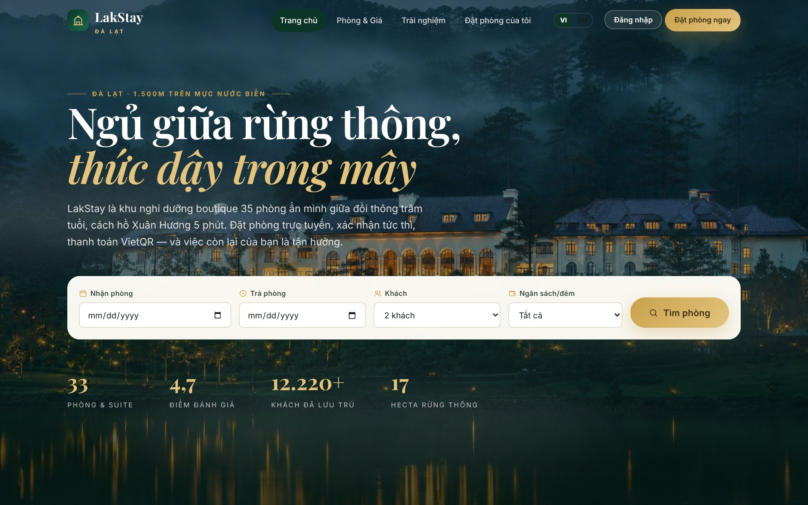 | 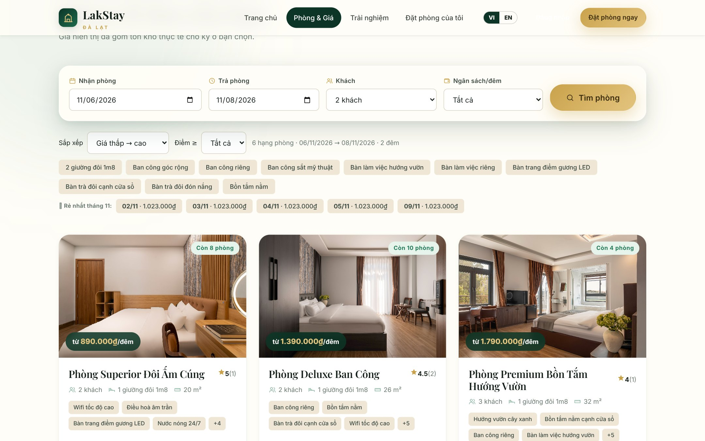 |
| Hero rừng thông Đà Lạt, bộ tìm kiếm theo ngày nhận/trả, số khách & ngân sách cùng thống kê trực tiếp từ DB. | Hiển thị tồn kho thực từng hạng phòng, lọc đa tiện nghi và thanh gợi ý **5 ngày có giá thấp nhất trong tháng**. |

| Chi tiết phòng, Gallery 4 góc chụp & Báo giá trực tiếp | Đặt phòng 4 bước & Thanh toán VietQR chuẩn EMVCo |
| :---: | :---: |
| 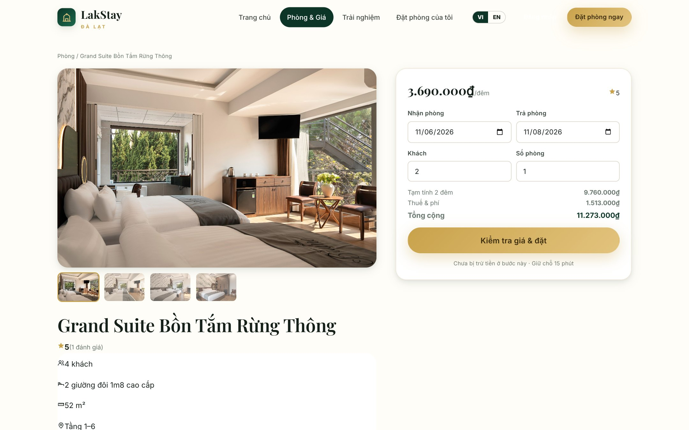 | 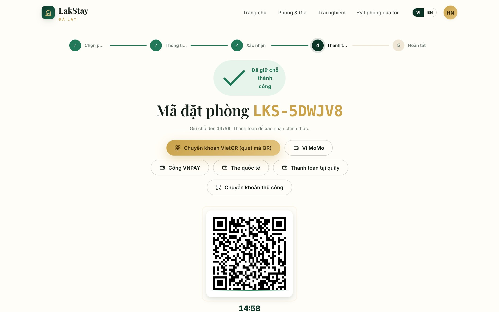 |
| Bộ 4 ảnh thực tế sắc nét, lịch trống 30 ngày, bảng chính sách huỷ 3 tầng và khung tính giá từng đêm + thuế/phí. | Giữ chỗ tạm thời 15 phút (`PENDING`), sinh mã **VietQR EMVCo + CRC-16/CCITT-FALSE** đúng số tiền & nội dung chuyển khoản. |

| Chi tiết đơn đã xác nhận, Voucher PDF & Huỷ linh hoạt | Chương trình Thành viên (Loyalty) & Hồ sơ cá nhân |
| :---: | :---: |
| 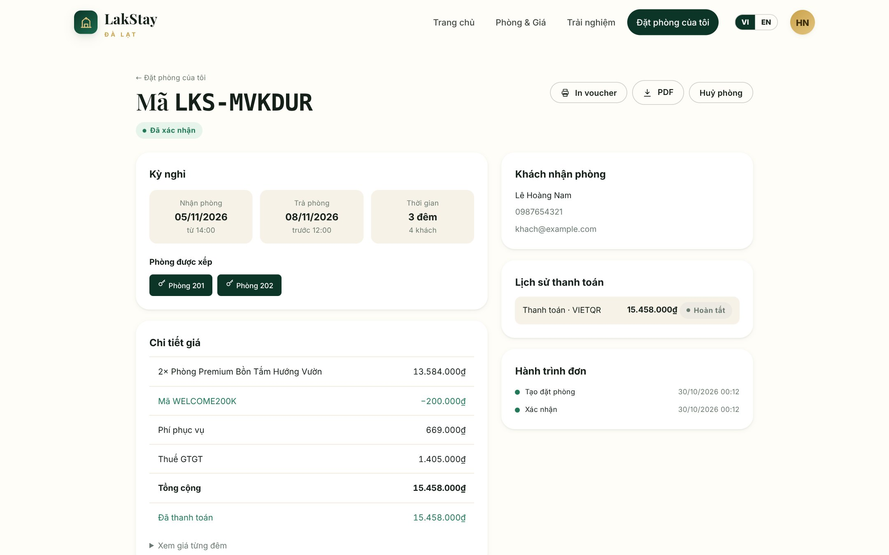 | 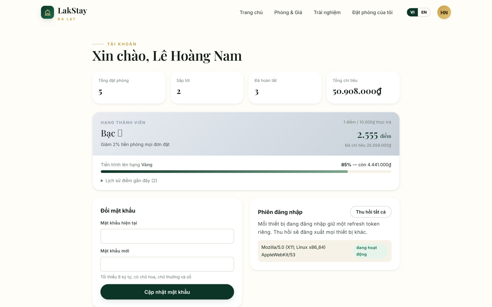 |
| Xem phòng vật lý được xếp (`Phòng 201, 202`), bóc tách giá minh bạch, in/tải **Voucher PDF A4** và xem trước tiền hoàn khi huỷ. | Tự động tích điểm sau thanh toán, nâng hạng `MEMBER → SILVER → GOLD → PLATINUM`, quản lý phiên đăng nhập & đổi mật khẩu. |

| Đa ngôn ngữ Tiếng Việt / Tiếng Anh (`VI / EN`) | Giao diện Tương thích Thiết bị Di động (Mobile 390px) |
| :---: | :---: |
| 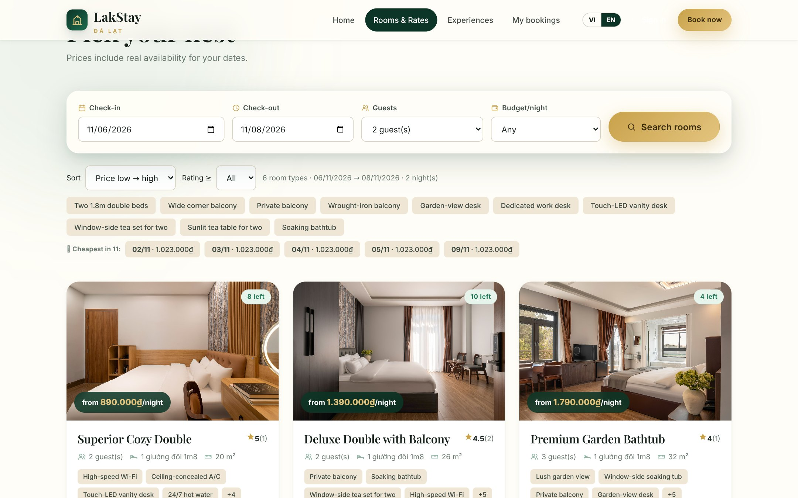 | 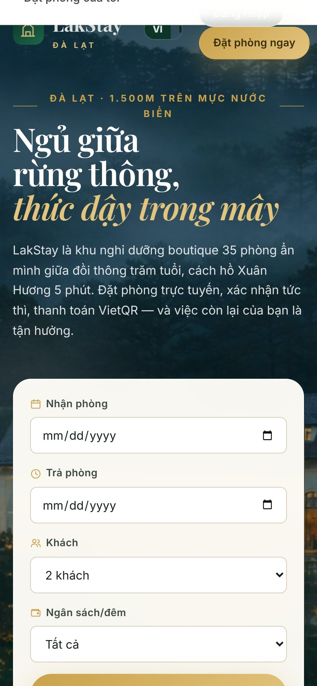 |
| Chuyển đổi tức thì `VI / EN` cho toàn bộ thanh điều hướng, tên phòng, mô tả phòng, tiện nghi và trạng thái đơn. | Bố cục tối ưu thao tác chạm trên điện thoại di động từ bước tìm kiếm đến thanh toán mã QR. |

---

### 2. Phân hệ Quản trị & Lễ tân (`/admin.html`)

| Bảng điều khiển (Dashboard KPI & Cảnh báo vận hành) | Quản lý Đặt phòng & Drawer chi tiết đơn |
| :---: | :---: |
| 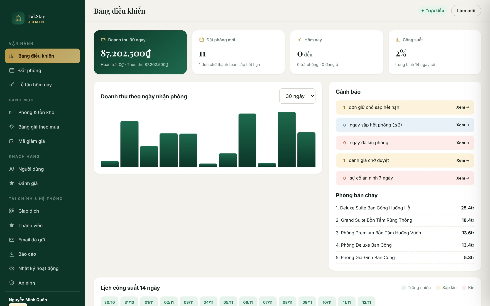 | 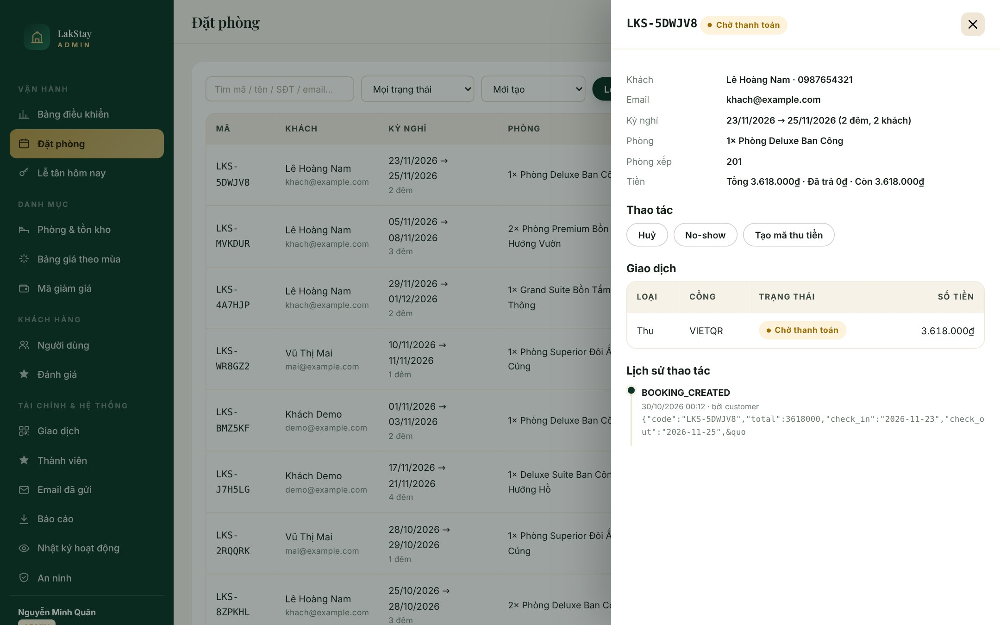 |
| Doanh thu thực thu (đã trừ hoàn tiền), công suất 14 ngày tới, cảnh báo đơn sắp hết hạn giữ chỗ, phòng sắp kín & sự cố an ninh. | Bộ lọc đa chiều kèm ngăn trượt (Drawer) xem chi tiết khách, phòng vật lý được xếp, chuyển trạng thái State Machine & lịch sử Audit. |

| Báo cáo Doanh thu, Công suất & Biểu đồ SVG | Kiểm duyệt Đánh giá & Phản hồi Khách hàng |
| :---: | :---: |
| 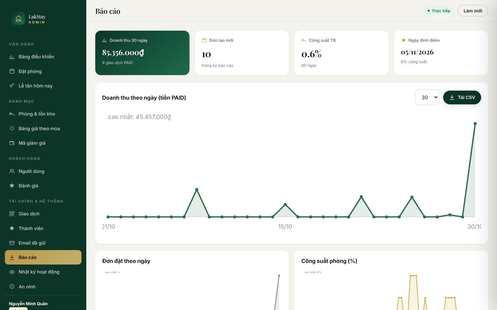 | 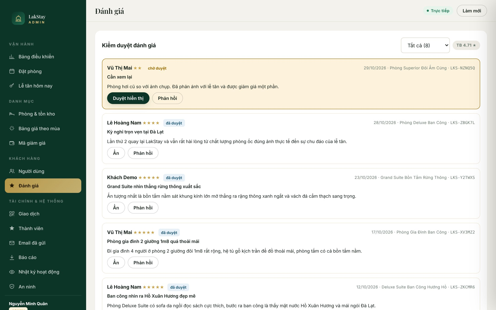 |
| Biểu đồ đường & miền SVG thuần theo chuỗi ngày (doanh thu PAID, số đơn tạo mới, tỷ lệ lấp đầy %) và xuất báo cáo **CSV**. | Duyệt / ẩn đánh giá chờ kiểm duyệt, gửi phản hồi chính thức từ Ban quản lý khách sạn hiển thị công khai trên trang phòng. |

---

## 🏨 Danh mục 6 Hạng phòng (35 phòng vật lý)

Toàn bộ hình ảnh và thông tin mô tả được đồng bộ chính xác với ảnh chụp nội thất & cảnh quan thực tế từ bộ sưu tập [`BrumeHotel`](https://github.com/lxmtuu/BrumeHotel):

| Hạng phòng (`slug`) | Diện tích | Sức chứa | Cấu hình giường | Số phòng | Giá cơ bản / đêm | Điểm nhấn không gian |
|---|:---:|:---:|---|:---:|---:|---|
| **Phòng Superior Đôi Ấm Cúng** (`standard-pine`) | 20 m² | 2 khách | 1 giường đôi 1m8 | 8 | **890.000₫** | Ốp gỗ sáng, vách lam gỗ & đá tự nhiên, bàn trang điểm gương tròn LED cảm ứng |
| **Phòng Deluxe Ban Công** (`deluxe-valley`) | 26 m² | 2 khách | 1 giường đôi 1m8 | 10 | **1.390.000₫** | Cửa kính sát trần rèm voan trắng mở ra ban công, bàn trà gỗ đôi & bồn tắm nằm |
| **Phòng Premium Bồn Tắm Hướng Vườn** (`premium-garden`) | 32 m² | 3 khách | 1 giường đôi 1m8 | 6 | **1.790.000₫** | Ban công sắt mỹ thuật nhìn vườn cây xanh mát, bồn tắm nằm đặt sát cửa sổ lớn |
| **Phòng Gia Đình Ban Công** (`family-suite`) | 35 m² | 4 khách | 2 giường đôi 1m8 | 5 | **2.290.000₫** | 2 giường đôi rộng rãi, hệ tủ gỗ kịch trần nhiều buồng, ban công thoáng & bồn tắm |
| **Deluxe Suite Ban Công Hướng Hồ** (`executive-lake`) | 45 m² | 2 khách | 1 giường King 1m8 + Sofa da | 4 | **2.890.000₫** | Gỗ óc chó trầm, sofa da Chesterfield cổ điển, ban công hướng Hồ Xuân Hương |
| **Grand Suite Bồn Tắm Rừng Thông** (`presidential-villa`) | 52 m² | 4 khách | 2 giường đôi 1m8 cao cấp | 2 | **3.690.000₫** | Vách đá cẩm thạch hắt sáng, cửa kính toàn cảnh & bồn tắm nhìn thẳng rừng thông |

---

## ✨ Điểm nhấn Kiến trúc & Nghiệp vụ Backend

1. **Chống Overbooking tuyệt đối ở tầng DB (`room_calendar` ledger)**
   - Tồn kho được quản lý theo từng ô `(room_type_id, date)` kèm ràng buộc `CHECK (booked_count <= total)` ngay trong SQLite.
   - Giữ chỗ chạy trong `db.transaction(...).immediate()` (`BEGIN IMMEDIATE`) kết hợp câu lệnh nguyên tử `UPDATE ... WHERE booked_count + :qty <= total` — đảm bảo dưới 40+ request đồng thời vẫn không bao giờ bán vượt số phòng thật.
   - Tích hợp bảng `room_blocks` cho phép Quản trị chặn lịch bảo trì phòng theo khoảng ngày, tự động trừ vào tồn kho khả dụng.

2. **Máy trạng thái Đặt phòng (Booking State Machine) & Optimistic Locking**
   - Vòng đời chặt chẽ: `PENDING → CONFIRMED → CHECKED_IN → COMPLETED`, cùng các nhánh `CANCELLED`, `EXPIRED`, `NO_SHOW`, `REFUNDED`.
   - Mọi thao tác chuyển trạng thái đều kiểm tra `version` (chống ghi đè đồng thời), tự động hoàn trả tồn kho khi huỷ/hết hạn và ghi vết đầy đủ vào `audit_logs`.

3. **Định giá Động theo Đêm, Mùa Lễ & Chính sách Huỷ 3 tầng**
   - Tính giá chi tiết từng đêm: `giá gốc × hệ số mùa cao điểm (price_rules) + phụ thu cuối tuần (T6/T7) + phụ thu khách vượt chuẩn − mã giảm giá (coupon) + phí phục vụ 5% + VAT 10%`.
   - Lưu `pricing_snapshot` vào đơn tại thời điểm đặt để đảm bảo tính bất biến của chứng từ kế toán dù bảng giá tương lai thay đổi.
   - Tự động tính tiền hoàn trả theo 3 mốc thời gian trước giờ check-in (miễn phí / phạt một phần / không hoàn).

4. **Thanh toán VietQR chuẩn EMVCo, Webhook HMAC & Idempotency**
   - Tự sinh chuỗi EMVCo chuẩn NAPAS 247 (AID `A000000727`) kèm mã kiểm tra **CRC-16/CCITT-FALSE** và dựng ảnh QR trực tiếp ở server (không phụ thuộc bên thứ ba).
   - Xác thực chữ ký webhook bằng `crypto.timingSafeEqual` trên `rawBody`, hỗ trợ `Idempotency-Key` chống tạo đơn / trừ tiền trùng khi mạng chập chờn.

5. **Voucher PDF A4 Tiếng Việt, Trang Xác thực QR & Email Outbox**
   - Phát hành **Voucher PDF A4** bằng `pdfkit` nhúng font Unicode `DejaVuSans.ttf` hiển thị trọn vẹn tiếng Việt kèm mã QR dẫn tới trang xác thực `/verify/:code` (tự động che bớt thông tin nhạy cảm của khách).
   - Tự động kết xuất email xác nhận đính kèm PDF lưu vào `outbox` (xem trực tiếp trong Admin `#/outbox`) hoặc gửi thật qua SMTP khi cấu hình.

6. **Bảo mật Thực chiến (Defense-in-Depth)**
   - Cookie phiên `httpOnly` + `SameSite=Lax`, **Refresh Token Rotation** phát hiện tái sử dụng token bị đánh cắp để thu hồi toàn bộ chuỗi phiên (`token family`).
   - Bảo vệ **CSRF Double-Submit**, giới hạn tần suất (**Rate Limit**), khoá tạm tài khoản khi đăng nhập sai liên tiếp (**Account Lockout**), kiểm tra chống **IDOR** và header bảo mật **Helmet CSP**.

---

## 🚀 Chạy nhanh tại máy cá nhân (Quick Start)

> Yêu cầu **Node.js 20.x hoặc 22.x LTS** (không cần cài Docker, Redis hay database server rời). Hướng dẫn chi tiết cho Windows / macOS / Linux xem tại **[docs/SETUP.md](docs/SETUP.md)**.

```bash
# 1. Cài đặt phụ thuộc
npm install

# 2. Tạo file cấu hình môi trường (mặc định dùng ngay cho môi trường dev)
cp .env.example .env          # Windows PowerShell: Copy-Item .env.example .env

# 3. Khởi tạo schema (18 bảng) & nạp dữ liệu mẫu
npm run setup

# 4. Khởi động máy chủ
npm start
```

Mở trình duyệt tại:
- **Website khách hàng:** `http://localhost:3000`
- **Trang Quản trị & Lễ tân:** `http://localhost:3000/admin.html`
- **Kiểm tra sức khoẻ hệ thống:** `http://localhost:3000/healthz`

---

## 🔑 Tài khoản & Mã giảm giá Demo

Mật khẩu dùng chung cho tất cả tài khoản mẫu: **`Lakstay@2026`**

| Vai trò | Email đăng nhập | Quyền hạn chính |
|---|---|---|
| **Quản trị viên (`admin`)** | `admin@lakstay.vn` | Toàn quyền hệ thống, cấu hình phòng/giá/coupon, hoàn tiền, phân quyền, báo cáo CSV, audit & an ninh |
| **Lễ tân (`staff`)** | `staff@lakstay.vn` | Bảng điều khiển, Lễ tân hôm nay (check-in / check-out), đối soát chuyển khoản, duyệt đánh giá |
| **Khách hàng (`customer`)** | `khach@example.com` | Đặt phòng, thanh toán VietQR, tải Voucher PDF, tích điểm hạng `SILVER`, huỷ đơn & viết đánh giá |
| **Khách hàng (`customer`)** | `demo@example.com` | Tài khoản khách hàng thứ hai (dùng kiểm thử phân tách quyền truy cập / chống IDOR) |

**Mã giảm giá (Coupon) có sẵn:**
- `DALAT10` — Giảm **10%** (tối đa `500.000₫`, áp dụng đơn từ `1.000.000₫`)
- `WELCOME200K` — Giảm thẳng **`200.000₫`** (đơn từ `1.500.000₫`)
- `MUAHE15` — Giảm **15%** (tối đa `1.000.000₫`, đơn từ `3.000.000₫`)
- `HETHANG` — Mã đã hết hạn (dùng kiểm thử thông báo lỗi nghiệp vụ)

---

## 🧪 Kiểm thử Tự động

```bash
# 1. Chạy 23 Unit Tests (CRC-16 VietQR, định giá theo mùa, máy trạng thái, huỷ phòng...)
npm test

# 2. Chạy 101 kiểm thử tích hợp E2E & 15 kiểm chứng chống Overbooking (cần bật server ở terminal khác)
npm start
npm run test:smoke
npm run test:concurrency
```

---

## ☁️ Triển khai Live Preview trên Vercel

Dự án tích hợp sẵn `api/index.js` và `vercel.json` để triển khai Full-Stack (Static CDN + Node.js Serverless API) lên **Vercel**:

- **Link bản chạy thực tế:** **[https://lakstay-demo.vercel.app](https://lakstay-demo.vercel.app)**
- Trên môi trường Serverless (`VERCEL=1`), ứng dụng tự động khởi tạo schema và nạp dữ liệu mẫu vào `/tmp/lakstay.db` ngay ở lần gọi đầu tiên (~100ms), đồng thời ghi hộp thư đi vào `/tmp/lakstay-outbox`.
- Khi tự deploy lên tài khoản Vercel của bạn, hãy cấu hình 4 biến môi trường trong **Project Settings → Environment Variables**:
  - `JWT_ACCESS_SECRET`, `JWT_REFRESH_SECRET`, `PAYMENT_WEBHOOK_SECRET` *(chuỗi ngẫu nhiên ≥ 32 ký tự)*
  - `DEMO_MODE=1` *(bật nút giả lập thanh toán VietQR cho khách trải nghiệm bản preview)*

---

## 🗂️ Cấu trúc Thư mục

```text
lakstay/
├── api/
│   └── index.js                   # Serverless entrypoint cho Vercel (tự động init & seed /tmp DB)
├── db/
│   ├── schema.sql                 # 18 bảng SQLite + trigger, index & CHECK constraint chống âm tồn kho
│   ├── init.js                    # Khởi tạo / làm mới cơ sở dữ liệu
│   └── seed.js                    # Dữ liệu mẫu thực tế (6 hạng phòng BrumeHotel, 35 phòng, booking, review)
├── src/
│   ├── server.js                  # Entrypoint HTTP server truyền thống + graceful shutdown
│   ├── app.js                     # Express pipeline: Helmet CSP, CORS, JSON rawBody, routes, /verify/:code
│   ├── db.js                      # Kết nối SQLite WAL + hệ thống schema_migrations tự động
│   ├── jobs.js                    # Tác vụ nền thu hồi giữ chỗ quá hạn, tự hoàn tất & đánh dấu no-show
│   ├── config/index.js            # Cấu hình tập trung + chốt chặn secret ở môi trường production
│   ├── assets/fonts/              # Font Unicode DejaVuSans.ttf nhúng vào Voucher PDF tiếng Việt
│   ├── middlewares/               # Xác thực JWT/Cookie, RBAC, CSRF, Idempotency-Key, Rate-limit, Zod
│   ├── services/                  # Nghiệp vụ lõi: booking, pricing, payment, vietqr, voucher, loyalty, mail
│   └── modules/                   # Tầng HTTP routes: auth, rooms, bookings, payments, reviews, loyalty, admin
├── public/                        # Giao diện khách hàng (index.html) & Quản trị/Lễ tân (admin.html) + 24 ảnh phòng
├── tests/                         # unit.test.js (23), smoke.js (101), concurrency.test.js (15 / 40 racers)
├── docs/                          # Tài liệu chi tiết + thư mục ảnh chụp giao diện docs/screenshots/
└── vercel.json                    # Cấu hình routing & đóng gói tài nguyên cho Vercel Serverless
```

---

## 📚 Tài liệu Chi tiết

| Tài liệu | Nội dung |
|---|---|
| **[docs/SETUP.md](docs/SETUP.md)** | Hướng dẫn cài đặt từng bước trên Windows / macOS / Linux, xử lý lỗi thường gặp, deploy Vercel & VPS |
| **[docs/ARCHITECTURE.md](docs/ARCHITECTURE.md)** | Phân tích thiết kế cơ sở dữ liệu, `BEGIN IMMEDIATE`, State Machine, VietQR CRC-16 và các đánh đổi kỹ thuật |
| **[docs/API.md](docs/API.md)** | Danh mục đầy đủ các REST/SSE endpoint, quyền truy cập, định dạng dữ liệu trả về và bảng mã lỗi |
| **[docs/SECURITY.md](docs/SECURITY.md)** | Mô hình mối đe doạ, cơ chế Refresh Token Rotation, CSRF, chống IDOR, HMAC Webhook & Audit Log |
| **[docs/ROADMAP.md](docs/ROADMAP.md)** | Lộ trình nâng cấp lên PostgreSQL, hàng đợi phân tán Redis/BullMQ, tích hợp OTA Channel Manager |
